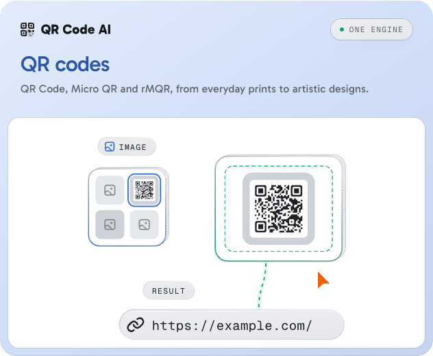
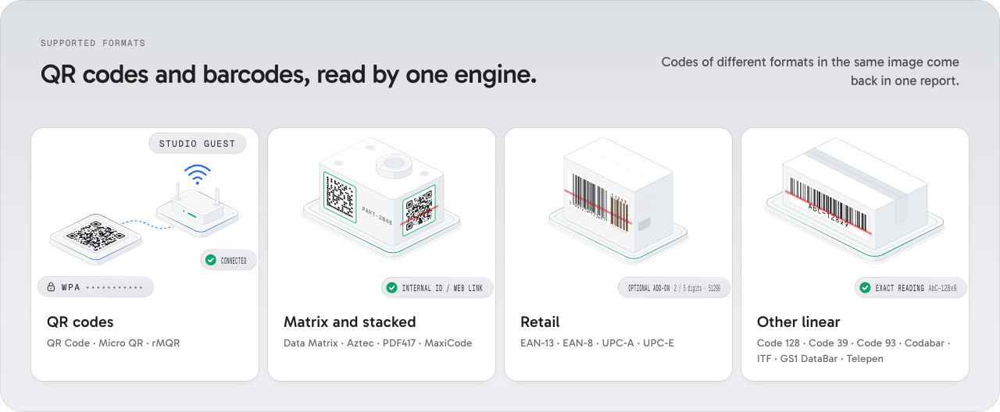
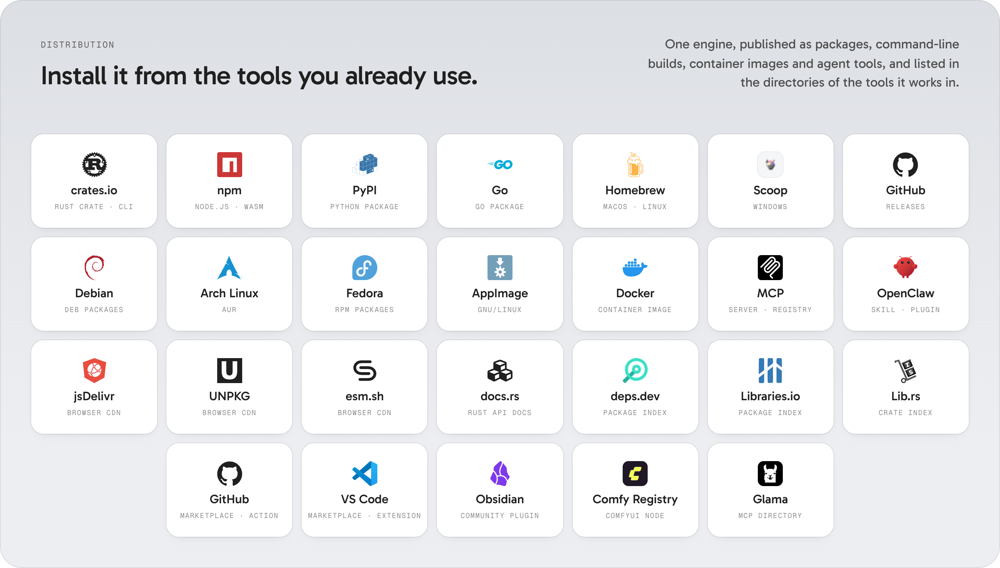
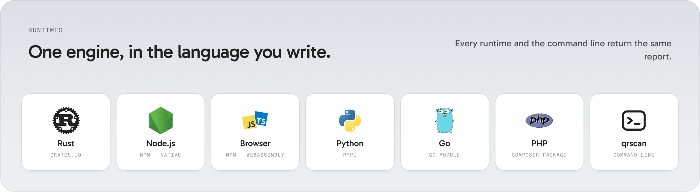
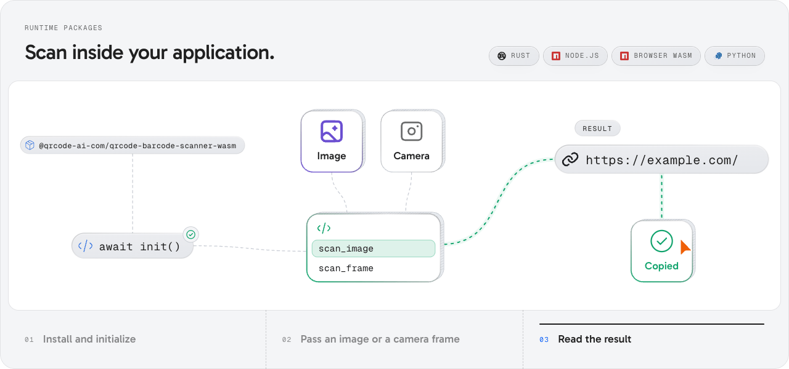
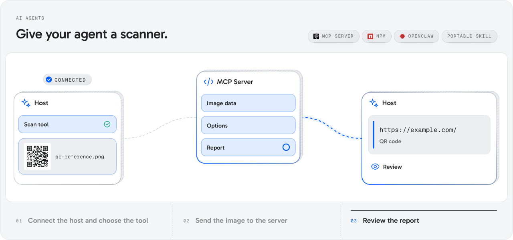
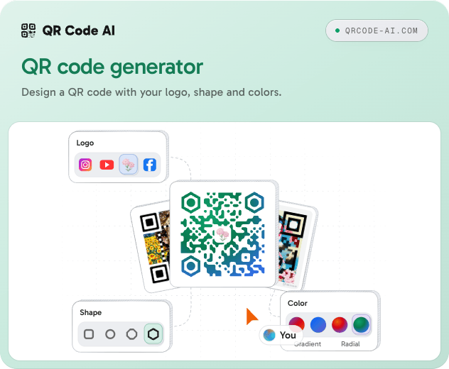
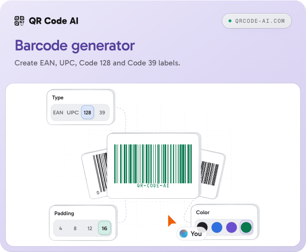

<p align="center">
  <a href="https://qrcode-ai.com">
    <picture>
      <source media="(prefers-color-scheme: dark)" type="image/webp" srcset="https://raw.githubusercontent.com/qrcode-ai-com/.github/main/profile/assets/hero-dark.webp?v=9266c9c7a2b8">
      <source type="image/webp" srcset="https://raw.githubusercontent.com/qrcode-ai-com/.github/main/profile/assets/hero-light.webp?v=95da8a16b7ad">
      <source media="(prefers-color-scheme: dark)" srcset="https://raw.githubusercontent.com/qrcode-ai-com/.github/main/profile/assets/hero-dark.gif?v=f61857923b22">
      
    </picture>
  </a>
</p>

# QR Code AI

**Open-source QR code and barcode technology.**

[QR Code AI](https://qrcode-ai.com) is an online [QR code generator](https://qrcode-ai.com/en-US/qr-code-generator) and [barcode generator](https://qrcode-ai.com/en-US/barcode-generator), with [custom designs](https://qrcode-ai.com/en-US/custom-qr-code), [QR code art](https://qrcode-ai.com/en-US/qr-code-art) and [scan tracking](https://qrcode-ai.com/en-US/tracking). This organization is where its technology is published as open source.

It starts with **[QR Code & Barcode Scanner](https://github.com/qrcode-ai-com/qrcode-barcode-scanner-rust)**: one Rust engine that reads QR codes and barcodes from images and camera frames, entirely on your device. More of QR Code AI will be published here as open source.

**[Scanner source](https://github.com/qrcode-ai-com/qrcode-barcode-scanner-rust)** · [Get started](https://github.com/qrcode-ai-com/qrcode-barcode-scanner-rust#get-started) · [Examples](https://github.com/qrcode-ai-com/qrcode-barcode-scanner-rust#examples) · [Releases](https://github.com/qrcode-ai-com/qrcode-barcode-scanner-rust/releases) · [Distribution guide](https://github.com/qrcode-ai-com/qrcode-barcode-scanner-rust/blob/main/distribution/README.md) · [qrcode-ai.com](https://qrcode-ai.com)

<!-- qrcode-ai-readme-actions:v2 -->

### Ask AI

[](https://chatgpt.com/?q=Help%20me%20understand%20the%20qrcode-ai-com%20GitHub%20organization%20%28profile%20README%29%20for%20QR%20Code%20%26%20Barcode%20Scanner%2C%20the%20open-source%20scanner.%20Organization%20profile%3B%20each%20package%20states%20its%20own%20publication.%20Provided%20README%20context%20%28verify%20against%20the%20sources%29%3A%20The%20organization%20publishes%20QR%20Code%20AI%20technology%20as%20open%20source%2C%20starting%20with%20one%20Rust%20engine%20that%20reads%20QR%20codes%20and%20barcodes%20from%20images%20and%20camera%20frames%20on%20the%20device%2C%20for%20Rust%2C%20Node.js%2C%20the%20browser%2C%20Python%2C%20Go%2C%20PHP%2C%20the%20command%20line%2C%20containers%20and%20AI%20agents.%20Read%20the%20public%20documentation%20below.%20Explain%20what%20this%20destination%20does%2C%20its%20documented%20installation%20or%20access%20steps%2C%20a%20minimal%20example%20if%20supported%2C%20prerequisites%2C%20limitations%20and%20license.%20Distinguish%20published%20packages%20from%20working%20source%20and%20preparation.%20Cite%20your%20sources%3B%20if%20a%20page%20is%20unavailable%20or%20a%20fact%20cannot%20be%20checked%2C%20say%20so.%20Do%20not%20invent%20installation%20commands%2C%20benchmark%20results%20or%20comparisons.%20Answer%20in%20my%20language.%20Public%20sources%3A%20https%3A%2F%2Fgithub.com%2Fqrcode-ai-com%20https%3A%2F%2Fgithub.com%2Fqrcode-ai-com%2Fqrcode-barcode-scanner-rust%20https%3A%2F%2Fgithub.com%2Fqrcode-ai-com%2Fqrcode-barcode-scanner-rust%2Fblob%2Fmain%2Fdistribution%2FREADME.md%20https%3A%2F%2Fqrcode-ai.com%2Fen-US%2Fqr-code-scanner%20https%3A%2F%2Fqrcode-ai.com%2Fen-US%2Fbarcode-scanner)
[](https://claude.ai/new?q=Help%20me%20understand%20the%20qrcode-ai-com%20GitHub%20organization%20%28profile%20README%29%20for%20QR%20Code%20%26%20Barcode%20Scanner%2C%20the%20open-source%20scanner.%20Organization%20profile%3B%20each%20package%20states%20its%20own%20publication.%20Provided%20README%20context%20%28verify%20against%20the%20sources%29%3A%20The%20organization%20publishes%20QR%20Code%20AI%20technology%20as%20open%20source%2C%20starting%20with%20one%20Rust%20engine%20that%20reads%20QR%20codes%20and%20barcodes%20from%20images%20and%20camera%20frames%20on%20the%20device%2C%20for%20Rust%2C%20Node.js%2C%20the%20browser%2C%20Python%2C%20Go%2C%20PHP%2C%20the%20command%20line%2C%20containers%20and%20AI%20agents.%20Read%20the%20public%20documentation%20below.%20Explain%20what%20this%20destination%20does%2C%20its%20documented%20installation%20or%20access%20steps%2C%20a%20minimal%20example%20if%20supported%2C%20prerequisites%2C%20limitations%20and%20license.%20Distinguish%20published%20packages%20from%20working%20source%20and%20preparation.%20Cite%20your%20sources%3B%20if%20a%20page%20is%20unavailable%20or%20a%20fact%20cannot%20be%20checked%2C%20say%20so.%20Do%20not%20invent%20installation%20commands%2C%20benchmark%20results%20or%20comparisons.%20Answer%20in%20my%20language.%20Public%20sources%3A%20https%3A%2F%2Fgithub.com%2Fqrcode-ai-com%20https%3A%2F%2Fgithub.com%2Fqrcode-ai-com%2Fqrcode-barcode-scanner-rust%20https%3A%2F%2Fgithub.com%2Fqrcode-ai-com%2Fqrcode-barcode-scanner-rust%2Fblob%2Fmain%2Fdistribution%2FREADME.md%20https%3A%2F%2Fqrcode-ai.com%2Fen-US%2Fqr-code-scanner%20https%3A%2F%2Fqrcode-ai.com%2Fen-US%2Fbarcode-scanner)
[](https://gemini.google.com/)
[](https://grok.com/?q=Help%20me%20understand%20the%20qrcode-ai-com%20GitHub%20organization%20%28profile%20README%29%20for%20QR%20Code%20%26%20Barcode%20Scanner%2C%20the%20open-source%20scanner.%20Organization%20profile%3B%20each%20package%20states%20its%20own%20publication.%20Provided%20README%20context%20%28verify%20against%20the%20sources%29%3A%20The%20organization%20publishes%20QR%20Code%20AI%20technology%20as%20open%20source%2C%20starting%20with%20one%20Rust%20engine%20that%20reads%20QR%20codes%20and%20barcodes%20from%20images%20and%20camera%20frames%20on%20the%20device%2C%20for%20Rust%2C%20Node.js%2C%20the%20browser%2C%20Python%2C%20Go%2C%20PHP%2C%20the%20command%20line%2C%20containers%20and%20AI%20agents.%20Read%20the%20public%20documentation%20below.%20Explain%20what%20this%20destination%20does%2C%20its%20documented%20installation%20or%20access%20steps%2C%20a%20minimal%20example%20if%20supported%2C%20prerequisites%2C%20limitations%20and%20license.%20Distinguish%20published%20packages%20from%20working%20source%20and%20preparation.%20Cite%20your%20sources%3B%20if%20a%20page%20is%20unavailable%20or%20a%20fact%20cannot%20be%20checked%2C%20say%20so.%20Do%20not%20invent%20installation%20commands%2C%20benchmark%20results%20or%20comparisons.%20Answer%20in%20my%20language.%20Public%20sources%3A%20https%3A%2F%2Fgithub.com%2Fqrcode-ai-com%20https%3A%2F%2Fgithub.com%2Fqrcode-ai-com%2Fqrcode-barcode-scanner-rust%20https%3A%2F%2Fgithub.com%2Fqrcode-ai-com%2Fqrcode-barcode-scanner-rust%2Fblob%2Fmain%2Fdistribution%2FREADME.md%20https%3A%2F%2Fqrcode-ai.com%2Fen-US%2Fqr-code-scanner%20https%3A%2F%2Fqrcode-ai.com%2Fen-US%2Fbarcode-scanner)
[](https://www.perplexity.ai/?q=Help%20me%20understand%20the%20qrcode-ai-com%20GitHub%20organization%20%28profile%20README%29%20for%20QR%20Code%20%26%20Barcode%20Scanner%2C%20the%20open-source%20scanner.%20Organization%20profile%3B%20each%20package%20states%20its%20own%20publication.%20Provided%20README%20context%20%28verify%20against%20the%20sources%29%3A%20The%20organization%20publishes%20QR%20Code%20AI%20technology%20as%20open%20source%2C%20starting%20with%20one%20Rust%20engine%20that%20reads%20QR%20codes%20and%20barcodes%20from%20images%20and%20camera%20frames%20on%20the%20device%2C%20for%20Rust%2C%20Node.js%2C%20the%20browser%2C%20Python%2C%20Go%2C%20PHP%2C%20the%20command%20line%2C%20containers%20and%20AI%20agents.%20Read%20the%20public%20documentation%20below.%20Explain%20what%20this%20destination%20does%2C%20its%20documented%20installation%20or%20access%20steps%2C%20a%20minimal%20example%20if%20supported%2C%20prerequisites%2C%20limitations%20and%20license.%20Distinguish%20published%20packages%20from%20working%20source%20and%20preparation.%20Cite%20your%20sources%3B%20if%20a%20page%20is%20unavailable%20or%20a%20fact%20cannot%20be%20checked%2C%20say%20so.%20Do%20not%20invent%20installation%20commands%2C%20benchmark%20results%20or%20comparisons.%20Answer%20in%20my%20language.%20Public%20sources%3A%20https%3A%2F%2Fgithub.com%2Fqrcode-ai-com%20https%3A%2F%2Fgithub.com%2Fqrcode-ai-com%2Fqrcode-barcode-scanner-rust%20https%3A%2F%2Fgithub.com%2Fqrcode-ai-com%2Fqrcode-barcode-scanner-rust%2Fblob%2Fmain%2Fdistribution%2FREADME.md%20https%3A%2F%2Fqrcode-ai.com%2Fen-US%2Fqr-code-scanner%20https%3A%2F%2Fqrcode-ai.com%2Fen-US%2Fbarcode-scanner)
[](https://copilot.com/)
[](https://chat.deepseek.com/)
[](https://www.meta.ai/)
[](https://qwen.ai/)

Choose an AI assistant to explain this destination using its public sources. Gemini opens gemini.google.com. Gemini, Copilot, DeepSeek, Meta AI and Qwen require pasting the prompt below; the other links include it in their URL. Sign-in or a manual paste may still be required. Check the answer against the documentation.

<details>
<summary>Copy the plain-text prompt</summary>

Use the code block's copy control, or select its complete text, then paste it into your assistant.

```text
Help me understand the qrcode-ai-com GitHub organization (profile README) for QR Code & Barcode Scanner, the open-source scanner. Organization profile; each package states its own publication. Provided README context (verify against the sources): The organization publishes QR Code AI technology as open source, starting with one Rust engine that reads QR codes and barcodes from images and camera frames on the device, for Rust, Node.js, the browser, Python, Go, PHP, the command line, containers and AI agents. Read the public documentation below. Explain what this destination does, its documented installation or access steps, a minimal example if supported, prerequisites, limitations and license. Distinguish published packages from working source and preparation. Cite your sources; if a page is unavailable or a fact cannot be checked, say so. Do not invent installation commands, benchmark results or comparisons. Answer in my language. Public sources: https://github.com/qrcode-ai-com https://github.com/qrcode-ai-com/qrcode-barcode-scanner-rust https://github.com/qrcode-ai-com/qrcode-barcode-scanner-rust/blob/main/distribution/README.md https://qrcode-ai.com/en-US/qr-code-scanner https://qrcode-ai.com/en-US/barcode-scanner
```

</details>

<!-- /qrcode-ai-readme-actions:v2 -->

## One engine for QR codes and barcodes

<p align="center">
  <a href="https://github.com/qrcode-ai-com/qrcode-barcode-scanner-rust#supported-formats"><picture><source media="(prefers-color-scheme: dark)" srcset="https://raw.githubusercontent.com/qrcode-ai-com/.github/main/profile/assets/engine-qr-codes-dark.gif?v=5e6c352d1b6e"></picture></a>
  <a href="https://github.com/qrcode-ai-com/qrcode-barcode-scanner-rust#supported-formats"><picture><source media="(prefers-color-scheme: dark)" srcset="https://raw.githubusercontent.com/qrcode-ai-com/.github/main/profile/assets/engine-barcodes-dark.gif?v=a726665fa990"></picture></a>
</p>

A QR code and a barcode are read by the same engine, in the same scan. An image that holds a QR code and a Code 128 label returns both, each with its value and its format, and its position when available. There is one scanner to install, whichever code you read.

<p align="center">
  <a href="https://github.com/qrcode-ai-com/qrcode-barcode-scanner-rust#supported-formats">
    <picture>
      <source media="(prefers-color-scheme: dark)" srcset="https://raw.githubusercontent.com/qrcode-ai-com/.github/main/profile/assets/formats-dark.gif?v=92fa0e8084df">
      
    </picture>
  </a>
</p>

| Family | Formats |
| --- | --- |
| QR | QR Code, Micro QR, rectangular Micro QR (rMQR) |
| Matrix and stacked | Data Matrix, Aztec, PDF417, MaxiCode |
| Retail | EAN-13, EAN-8, UPC-A, UPC-E |
| Other linear | Code 128, Code 39, Code 93, Codabar, ITF, GS1 DataBar, GS1 DataBar Expanded, Telepen |

The engine also scores how reliably a QR design can be read, a check QR Code AI uses before export.

| | QR codes | Barcodes |
| --- | --- | --- |
| **Try the scanner live** | [QR code scanner](https://qrcode-ai.com/en-US/qr-code-scanner) | [Barcode scanner](https://qrcode-ai.com/en-US/barcode-scanner) |
| **Developer guide** | [QR code scanner SDK](https://qrcode-ai.com/en-US/qr-code-scanner/sdk) | [Barcode scanner SDK](https://qrcode-ai.com/en-US/barcode-scanner/sdk) |
| **Create a code** | [QR code generator](https://qrcode-ai.com/en-US/qr-code-generator) | [Barcode generator](https://qrcode-ai.com/en-US/barcode-generator) |

## How it works

1. **Install the engine where the image is handled.** Add a runtime package to your application, use the `qrscan` command line, run the container image, or connect an AI agent through MCP. The routes are listed below.
2. **Give it an image or a camera frame.** The engine looks for every QR code and barcode in it, on your device; the image is not uploaded.
3. **Read the report.** Each code comes back with its value and its format, and its position when available. The same report is returned whichever route you chose.

## Install it from the tools you already use

<p align="center">
  <a href="https://github.com/qrcode-ai-com/qrcode-barcode-scanner-rust/blob/main/distribution/README.md">
    <picture>
      <source media="(prefers-color-scheme: dark)" srcset="https://raw.githubusercontent.com/qrcode-ai-com/.github/main/profile/assets/destinations-dark.png?v=e096a59ccab2">
      
    </picture>
  </a>
</p>

The engine is published where developers already install software. Choose by where the image is handled: inside your application, in a terminal, in a container or through an AI agent. Every route runs the same engine and returns its report.

### Runtime packages

<p align="center">
  <a href="https://github.com/qrcode-ai-com/qrcode-barcode-scanner-rust#get-started">
    <picture>
      <source media="(prefers-color-scheme: dark)" srcset="https://raw.githubusercontent.com/qrcode-ai-com/.github/main/profile/assets/runtimes-dark.png?v=57c63428574b">
      
    </picture>
  </a>
</p>

<p align="center">
  <a href="https://github.com/qrcode-ai-com/qrcode-barcode-scanner-rust#get-started">
    <picture>
      <source media="(prefers-color-scheme: dark)" srcset="https://raw.githubusercontent.com/qrcode-ai-com/.github/main/profile/assets/journey-packages-dark.gif?v=50f76ea0d290">
      
    </picture>
  </a>
</p>

| Runtime | Install | Published on |
| :---: | --- | --- |
| <a href="https://github.com/qrcode-ai-com/qrcode-barcode-scanner-rust/tree/main/crates/qrcode-ai-scanner#readme"><picture><source media="(prefers-color-scheme: dark)" srcset="https://raw.githubusercontent.com/qrcode-ai-com/.github/main/profile/assets/mark-lang-rust-dark.png?v=31b5deebc32e"></picture></a><br>**Rust** | `cargo add qrcode-barcode-scanner` | [crates.io](https://crates.io/crates/qrcode-barcode-scanner) · API on [docs.rs](https://docs.rs/qrcode-barcode-scanner) |
| <a href="https://github.com/qrcode-ai-com/qrcode-barcode-scanner-rust/tree/main/crates/qrcode-ai-scanner-node#readme"><picture><source media="(prefers-color-scheme: dark)" srcset="https://raw.githubusercontent.com/qrcode-ai-com/.github/main/profile/assets/mark-lang-nodejs-dark.png?v=cf2159524fc6"></picture></a><br>**Node.js** | `npm install @qrcode-ai-com/qrcode-barcode-scanner` | [npm](https://www.npmjs.com/package/@qrcode-ai-com/qrcode-barcode-scanner) · native macOS, Linux, Windows |
| <a href="https://github.com/qrcode-ai-com/qrcode-barcode-scanner-rust/tree/main/crates/qrcode-ai-scanner-wasm#readme"><picture><source media="(prefers-color-scheme: dark)" srcset="https://raw.githubusercontent.com/qrcode-ai-com/.github/main/profile/assets/mark-lang-browser-dark.png?v=bbe2f3560a6d"></picture></a><br>**Browser** | `npm install @qrcode-ai-com/qrcode-barcode-scanner-wasm` | [npm](https://www.npmjs.com/package/@qrcode-ai-com/qrcode-barcode-scanner-wasm) · WASM and camera components |
| <a href="https://github.com/qrcode-ai-com/qrcode-barcode-scanner-rust/tree/main/crates/qrcode-ai-scanner-py#readme"><picture><source media="(prefers-color-scheme: dark)" srcset="https://raw.githubusercontent.com/qrcode-ai-com/.github/main/profile/assets/mark-lang-python-dark.png?v=7469c3e0b4fb"></picture></a><br>**Python** | `python -m pip install qrcode-barcode-scanner` | [PyPI](https://pypi.org/project/qrcode-barcode-scanner/) |
| <a href="https://github.com/qrcode-ai-com/qrcode-barcode-scanner-go"><picture><source media="(prefers-color-scheme: dark)" srcset="https://raw.githubusercontent.com/qrcode-ai-com/.github/main/profile/assets/mark-lang-go-dark.png?v=b6dbac901176"></picture></a><br>**Go** | `go get github.com/qrcode-ai-com/qrcode-barcode-scanner-go` | [pkg.go.dev](https://pkg.go.dev/github.com/qrcode-ai-com/qrcode-barcode-scanner-go) · drives `qrscan` |
| <a href="https://github.com/qrcode-ai-com/qrcode-barcode-scanner-php"><picture><source media="(prefers-color-scheme: dark)" srcset="https://raw.githubusercontent.com/qrcode-ai-com/.github/main/profile/assets/mark-lang-php-dark.png?v=3800932934c8"></picture></a><br>**PHP** | [Source and guide](https://github.com/qrcode-ai-com/qrcode-barcode-scanner-php#readme) | [GitHub](https://github.com/qrcode-ai-com/qrcode-barcode-scanner-php) · drives `qrscan` |

The Rust, Node.js, browser and Python packages hold the engine. The Go and PHP packages hold no decoder: each one drives the installed `qrscan` command and returns its report. Each logo opens the guide of its runtime.

### Command line

<p align="center">
  <a href="https://github.com/qrcode-ai-com/qrcode-barcode-scanner-rust#command-line">
    <picture>
      <source media="(prefers-color-scheme: dark)" srcset="https://raw.githubusercontent.com/qrcode-ai-com/.github/main/profile/assets/journey-cli-dark.gif?v=d6e7adecaaf2">
      
    </picture>
  </a>
</p>

`qrscan` is the engine as a command: it reads an image file and prints a JSON report.

| Channel | Install | Platforms |
| :---: | --- | --- |
| <a href="https://github.com/qrcode-ai-com/homebrew-tap"><picture><source media="(prefers-color-scheme: dark)" srcset="https://raw.githubusercontent.com/qrcode-ai-com/.github/main/profile/assets/mark-homebrew-dark.png?v=d408ba800294"></picture></a><br>**[Homebrew](https://github.com/qrcode-ai-com/homebrew-tap)** | `brew install qrcode-ai-com/tap/qrscan` | macOS and GNU/Linux |
| <a href="https://github.com/qrcode-ai-com/scoop-bucket"><picture><source media="(prefers-color-scheme: dark)" srcset="https://raw.githubusercontent.com/qrcode-ai-com/.github/main/profile/assets/mark-scoop-dark.png?v=acab24ad6857"></picture></a><br>**[Scoop](https://github.com/qrcode-ai-com/scoop-bucket)** | `scoop bucket add qrcode-ai https://github.com/qrcode-ai-com/scoop-bucket`<br>`scoop install qrcode-ai/qrcode-barcode-scanner` | Windows x64 |
| <a href="https://crates.io/crates/qrcode-barcode-scanner-cli"><picture><source media="(prefers-color-scheme: dark)" srcset="https://raw.githubusercontent.com/qrcode-ai-com/.github/main/profile/assets/mark-rust-dark.png?v=29c91f35ae96"></picture></a><br>**[Cargo](https://crates.io/crates/qrcode-barcode-scanner-cli)** | `cargo install qrcode-barcode-scanner-cli --locked` | Any Rust toolchain |
| <a href="https://github.com/qrcode-ai-com/qrcode-barcode-scanner-rust/releases"><picture><source media="(prefers-color-scheme: dark)" srcset="https://raw.githubusercontent.com/qrcode-ai-com/.github/main/profile/assets/mark-github-dark.png?v=1beef6411e01"></picture></a><br>**[Releases](https://github.com/qrcode-ai-com/qrcode-barcode-scanner-rust/releases)** | [Download and verify an archive](https://github.com/qrcode-ai-com/qrcode-barcode-scanner-rust/blob/main/distribution/cli/README.md#download-and-verify) | macOS, GNU/Linux, Windows |
| <a href="https://github.com/qrcode-ai-com/qrcode-barcode-scanner-rust/blob/main/distribution/README.md#cli-and-containers"><picture><source media="(prefers-color-scheme: dark)" srcset="https://raw.githubusercontent.com/qrcode-ai-com/.github/main/profile/assets/mark-debian-dark.png?v=fe0bc2eb1292"></picture></a><br>**Debian** | [Install the `.deb` package](https://github.com/qrcode-ai-com/qrcode-barcode-scanner-rust/blob/main/distribution/README.md#cli-and-containers) | Debian 12, Ubuntu 24.04 |
| <a href="https://aur.archlinux.org/packages/qrcode-barcode-scanner-bin"><picture><source media="(prefers-color-scheme: dark)" srcset="https://raw.githubusercontent.com/qrcode-ai-com/.github/main/profile/assets/mark-archlinux-dark.png?v=a5c779b6e553"></picture></a><br>**[AUR](https://aur.archlinux.org/packages/qrcode-barcode-scanner-bin)** | [Arch install guide](https://github.com/qrcode-ai-com/qrcode-barcode-scanner-rust/blob/main/distribution/aur/README.md) | Arch Linux x86_64 |
| <a href="https://github.com/qrcode-ai-com/qrcode-barcode-scanner-rust/blob/main/distribution/README.md#cli-and-containers"><picture><source media="(prefers-color-scheme: dark)" srcset="https://raw.githubusercontent.com/qrcode-ai-com/.github/main/profile/assets/mark-fedora-dark.png?v=cf9efdf2c0c6"></picture></a><br>**Fedora** | [Install the RPM package](https://github.com/qrcode-ai-com/qrcode-barcode-scanner-rust/blob/main/distribution/README.md#cli-and-containers) | Fedora 44 |
| <a href="https://github.com/qrcode-ai-com/qrcode-barcode-scanner-rust/blob/main/distribution/README.md#cli-and-containers"><picture><source media="(prefers-color-scheme: dark)" srcset="https://raw.githubusercontent.com/qrcode-ai-com/.github/main/profile/assets/mark-appimage-dark.png?v=b2fb5a4f1434"></picture></a><br>**AppImage** | [Run the AppImage](https://github.com/qrcode-ai-com/qrcode-barcode-scanner-rust/blob/main/distribution/README.md#cli-and-containers), one file with nothing to install | GNU/Linux |

### Containers

<p align="center">
  <a href="https://github.com/qrcode-ai-com/qrcode-barcode-scanner-rust/blob/main/distribution/README.md#cli-and-containers">
    <picture>
      <source media="(prefers-color-scheme: dark)" srcset="https://raw.githubusercontent.com/qrcode-ai-com/.github/main/profile/assets/journey-containers-dark.gif?v=d2a1fed91c26">
      
    </picture>
  </a>
</p>

| Registry | Image | Platforms |
| :---: | --- | --- |
| <a href="https://github.com/qrcode-ai-com/qrcode-barcode-scanner-rust/pkgs/container/qrcode-barcode-scanner"><picture><source media="(prefers-color-scheme: dark)" srcset="https://raw.githubusercontent.com/qrcode-ai-com/.github/main/profile/assets/mark-docker-dark.png?v=111f4320e3a8"></picture></a><br>**GHCR** | [`ghcr.io/qrcode-ai-com/qrcode-barcode-scanner`](https://github.com/qrcode-ai-com/qrcode-barcode-scanner-rust/pkgs/container/qrcode-barcode-scanner) on GitHub Container Registry. The [container guide](https://github.com/qrcode-ai-com/qrcode-barcode-scanner-rust/blob/main/distribution/README.md#cli-and-containers) shows how to run it. | Linux AMD64 and ARM64 |

### AI agents

<p align="center">
  <a href="https://github.com/qrcode-ai-com/qrcode-barcode-scanner-rust/blob/main/distribution/README.md#published-agent-integrations">
    <picture>
      <source media="(prefers-color-scheme: dark)" srcset="https://raw.githubusercontent.com/qrcode-ai-com/.github/main/profile/assets/journey-agents-dark.gif?v=40259e2ce31c">
      
    </picture>
  </a>
</p>

| Integration | Published as | Set up |
| :---: | --- | --- |
| <a href="https://www.npmjs.com/package/@qrcode-ai-com/qrcode-barcode-scanner-mcp"><picture><source media="(prefers-color-scheme: dark)" srcset="https://raw.githubusercontent.com/qrcode-ai-com/.github/main/profile/assets/mark-mcp-dark.png?v=c72c5de9be05"></picture></a><br>**MCP server** | [`@qrcode-ai-com/qrcode-barcode-scanner-mcp`](https://www.npmjs.com/package/@qrcode-ai-com/qrcode-barcode-scanner-mcp) on npm, listed in the [Official MCP Registry](https://registry.modelcontextprotocol.io/v0.1/servers/io.github.qrcode-ai-com%2Fqrcode-barcode-scanner/versions/latest) | [MCP installation](https://github.com/qrcode-ai-com/qrcode-barcode-scanner-rust/tree/main/integrations/mcp) |
| <a href="https://clawhub.ai/qrcode-ai-com/skills/qrcode-barcode-scanner"><picture><source media="(prefers-color-scheme: dark)" srcset="https://raw.githubusercontent.com/qrcode-ai-com/.github/main/profile/assets/mark-openclaw-dark.png?v=9fcbd222bc5c"></picture></a><br>**Portable skill** | [`qrcode-barcode-scanner`](https://clawhub.ai/qrcode-ai-com/skills/qrcode-barcode-scanner) on ClawHub | [Skill instructions](https://github.com/qrcode-ai-com/qrcode-barcode-scanner-rust/tree/main/skills/qrcode-barcode-scanner) |
| <a href="https://clawhub.ai/qrcode-ai-com/plugins/qrcode-barcode-scanner"><picture><source media="(prefers-color-scheme: dark)" srcset="https://raw.githubusercontent.com/qrcode-ai-com/.github/main/profile/assets/mark-openclaw-dark.png?v=9fcbd222bc5c"></picture></a><br>**OpenClaw plugin** | [`@qrcode-ai-com/qrcode-barcode-scanner`](https://clawhub.ai/qrcode-ai-com/plugins/qrcode-barcode-scanner) on ClawHub | [Plugin setup](https://github.com/qrcode-ai-com/qrcode-barcode-scanner-rust/tree/main/integrations/openclaw) |

### In the tools you work in

| Integration | Listed as | Set up |
| :---: | --- | --- |
| <a href="https://github.com/marketplace/actions/qr-code-barcode-scanner"><picture><source media="(prefers-color-scheme: dark)" srcset="https://raw.githubusercontent.com/qrcode-ai-com/.github/main/profile/assets/mark-github-dark.png?v=1beef6411e01"></picture></a><br>**GitHub Action** | [`qr-code-barcode-scanner`](https://github.com/marketplace/actions/qr-code-barcode-scanner) on the GitHub Marketplace | [Action guide](https://github.com/qrcode-ai-com/qrcode-barcode-scanner-rust/tree/main/integrations/github-action) |
| <a href="https://marketplace.visualstudio.com/items?itemName=qrcode-ai-com.qrcode-barcode-scanner"><picture><source media="(prefers-color-scheme: dark)" srcset="https://raw.githubusercontent.com/qrcode-ai-com/.github/main/profile/assets/mark-vscode-dark.png?v=46ba2f064426"></picture></a><br>**VS Code extension** | [`qrcode-ai-com.qrcode-barcode-scanner`](https://marketplace.visualstudio.com/items?itemName=qrcode-ai-com.qrcode-barcode-scanner) on the Visual Studio Marketplace | [Extension guide](https://github.com/qrcode-ai-com/qrcode-barcode-scanner-rust/tree/main/integrations/vscode) |
| <a href="https://community.obsidian.md/plugins/qrcode-barcode-scanner"><picture><source media="(prefers-color-scheme: dark)" srcset="https://raw.githubusercontent.com/qrcode-ai-com/.github/main/profile/assets/mark-obsidian-dark.png?v=43f72b4f65c1"></picture></a><br>**Obsidian plugin** | [`qrcode-barcode-scanner`](https://community.obsidian.md/plugins/qrcode-barcode-scanner) in the Obsidian community plugins | [Plugin guide](https://github.com/qrcode-ai-com/qrcode-barcode-scanner-rust/tree/main/integrations/obsidian) |
| <a href="https://registry.comfy.org/nodes/qrcode-barcode-scanner-nodes"><picture><source media="(prefers-color-scheme: dark)" srcset="https://raw.githubusercontent.com/qrcode-ai-com/.github/main/profile/assets/mark-comfyui-dark.png?v=96af9ee25553"></picture></a><br>**ComfyUI node** | [`qrcode-barcode-scanner-nodes`](https://registry.comfy.org/nodes/qrcode-barcode-scanner-nodes) on the Comfy Registry | [Node guide](https://github.com/qrcode-ai-com/qrcode-barcode-scanner-rust/tree/main/integrations/comfyui) |
| <a href="https://glama.ai/mcp/servers/qrcode-ai-com/qrcode-barcode-scanner-mcp"><picture><source media="(prefers-color-scheme: dark)" srcset="https://raw.githubusercontent.com/qrcode-ai-com/.github/main/profile/assets/mark-glama-dark.png?v=cd36fc162618"></picture></a><br>**MCP server on Glama** | [`qrcode-barcode-scanner-mcp`](https://glama.ai/mcp/servers/qrcode-ai-com/qrcode-barcode-scanner-mcp) in the Glama MCP directory | [Glama setup](https://github.com/qrcode-ai-com/qrcode-barcode-scanner-rust/tree/main/distribution/glama) |

The integrations for n8n, Node-RED, Activepieces, Raycast, Dify, Apify, napari and the browsers are built and tested in the [engine repository](https://github.com/qrcode-ai-com/qrcode-barcode-scanner-rust/tree/main/integrations) and wait for their stores.

### Browser CDNs and package indexes

| <a href="https://www.jsdelivr.com/package/npm/@qrcode-ai-com/qrcode-barcode-scanner-wasm"><picture><source media="(prefers-color-scheme: dark)" srcset="https://raw.githubusercontent.com/qrcode-ai-com/.github/main/profile/assets/mark-jsdelivr-dark.png?v=704e9fe56573"></picture></a> | <a href="https://unpkg.com/browse/@qrcode-ai-com/qrcode-barcode-scanner-wasm/"><picture><source media="(prefers-color-scheme: dark)" srcset="https://raw.githubusercontent.com/qrcode-ai-com/.github/main/profile/assets/mark-unpkg-dark.png?v=9240e361b8bd"></picture></a> | <a href="https://esm.sh/@qrcode-ai-com/qrcode-barcode-scanner-wasm"><picture><source media="(prefers-color-scheme: dark)" srcset="https://raw.githubusercontent.com/qrcode-ai-com/.github/main/profile/assets/mark-esm-dark.png?v=f28f1715017a"></picture></a> | <a href="https://docs.rs/qrcode-barcode-scanner"><picture><source media="(prefers-color-scheme: dark)" srcset="https://raw.githubusercontent.com/qrcode-ai-com/.github/main/profile/assets/mark-docsrs-dark.png?v=a4db02014c02"></picture></a> | <a href="https://deps.dev/npm/%40qrcode-ai-com%2Fqrcode-barcode-scanner"><picture><source media="(prefers-color-scheme: dark)" srcset="https://raw.githubusercontent.com/qrcode-ai-com/.github/main/profile/assets/mark-depsdev-dark.png?v=e866b7c993df"></picture></a> | <a href="https://libraries.io/npm/@qrcode-ai-com%2Fqrcode-barcode-scanner"><picture><source media="(prefers-color-scheme: dark)" srcset="https://raw.githubusercontent.com/qrcode-ai-com/.github/main/profile/assets/mark-librariesio-dark.png?v=fb6425afbe1c"></picture></a> | <a href="https://lib.rs/crates/qrcode-barcode-scanner"><picture><source media="(prefers-color-scheme: dark)" srcset="https://raw.githubusercontent.com/qrcode-ai-com/.github/main/profile/assets/mark-librs-dark.png?v=cbc60370271d"></picture></a> |
| :---: | :---: | :---: | :---: | :---: | :---: | :---: |
| [jsDelivr](https://www.jsdelivr.com/package/npm/@qrcode-ai-com/qrcode-barcode-scanner-wasm) | [UNPKG](https://unpkg.com/browse/@qrcode-ai-com/qrcode-barcode-scanner-wasm/) | [esm.sh](https://esm.sh/@qrcode-ai-com/qrcode-barcode-scanner-wasm) | [docs.rs](https://docs.rs/qrcode-barcode-scanner) | [deps.dev](https://deps.dev/npm/%40qrcode-ai-com%2Fqrcode-barcode-scanner) | [Libraries.io](https://libraries.io/npm/@qrcode-ai-com%2Fqrcode-barcode-scanner) | [Lib.rs](https://lib.rs/crates/qrcode-barcode-scanner) |
| Browser CDN | Browser CDN | Browser CDN | Rust API | Package index | Package index | Crate index |

The CDNs serve the npm browser package. The indexes describe the packages published to npm and crates.io.

<sub>Language, platform and host names and logos belong to their owners. They identify a runtime, show where a package is published or name a host that lists it, and imply no endorsement. The Go gopher was designed by Renée French ([CC BY 4.0](https://creativecommons.org/licenses/by/4.0/)); the PHP logo was designed by Colin Viebrock ([CC BY-SA 4.0](https://creativecommons.org/licenses/by-sa/4.0/)).</sub>

## Create the codes it reads

<p align="center">
  <a href="https://qrcode-ai.com/en-US/qr-code-generator"><picture><source media="(prefers-color-scheme: dark)" srcset="https://raw.githubusercontent.com/qrcode-ai-com/.github/main/profile/assets/create-qr-code-dark.gif?v=c151500f5b38"></picture></a>
  <a href="https://qrcode-ai.com/en-US/barcode-generator"><picture><source media="(prefers-color-scheme: dark)" srcset="https://raw.githubusercontent.com/qrcode-ai-com/.github/main/profile/assets/create-barcode-dark.gif?v=3864666d3b3d"></picture></a>
</p>

Reading a code is half of its life. On [qrcode-ai.com](https://qrcode-ai.com) you create the QR codes and barcodes that scanners read, then follow how they are used.

| | On qrcode-ai.com |
| --- | --- |
| **QR codes** | [QR code generator](https://qrcode-ai.com/en-US/qr-code-generator) · [Custom QR code with logo and colors](https://qrcode-ai.com/en-US/custom-qr-code) · [QR code templates](https://qrcode-ai.com/en-US/custom-qr-code/templates) · [QR code art](https://qrcode-ai.com/en-US/qr-code-art) · [QR code art templates](https://qrcode-ai.com/en-US/qr-code-art/templates) |
| **QR code types** | [Link](https://qrcode-ai.com/en-US/qr-code-generator/link) · [Wi-Fi](https://qrcode-ai.com/en-US/qr-code-generator/wifi) · [vCard](https://qrcode-ai.com/en-US/qr-code-generator/vcard) · [PDF](https://qrcode-ai.com/en-US/qr-code-generator/pdf) · [Menu](https://qrcode-ai.com/en-US/qr-code-generator/menu) · [WhatsApp](https://qrcode-ai.com/en-US/qr-code-generator/whatsapp) · [Email](https://qrcode-ai.com/en-US/qr-code-generator/email) · [SMS](https://qrcode-ai.com/en-US/qr-code-generator/sms) · [Text](https://qrcode-ai.com/en-US/qr-code-generator/text) · [GitHub](https://qrcode-ai.com/en-US/qr-code-generator/github) |
| **Barcodes** | [Barcode generator](https://qrcode-ai.com/en-US/barcode-generator) · [Code 128](https://qrcode-ai.com/en-US/barcode-generator/code-128) · [EAN-13](https://qrcode-ai.com/en-US/barcode-generator/ean-13) · [UPC-A](https://qrcode-ai.com/en-US/barcode-generator/upc-a) · [Data Matrix](https://qrcode-ai.com/en-US/barcode-generator/data-matrix) · [GS1-128](https://qrcode-ai.com/en-US/barcode-generator/gs1-128) · [ITF-14](https://qrcode-ai.com/en-US/barcode-generator/itf-14) · [Code 39](https://qrcode-ai.com/en-US/barcode-generator/code-39) |
| **After the scan** | [QR code tracking and analytics](https://qrcode-ai.com/en-US/tracking) · [URL shortener](https://qrcode-ai.com/en-US/url-shortener) · [Deep link generator](https://qrcode-ai.com/en-US/deep-link-generator) · [UTM builder](https://qrcode-ai.com/en-US/utm-builder) |
| **Learn** | [What is a QR code?](https://qrcode-ai.com/en-US/qr-code) · [What is a barcode?](https://qrcode-ai.com/en-US/barcode) · [All features](https://qrcode-ai.com/en-US/features) |

## Open source

- **License.** The scanner's project-authored source is under the MIT License; published archives retain their packaged license. The [licensing guide](https://github.com/qrcode-ai-com/qrcode-barcode-scanner-rust/blob/main/LICENSING.md) gives the detail.
- **Contributing.** Read the [contribution guide](https://github.com/qrcode-ai-com/qrcode-barcode-scanner-rust/blob/main/CONTRIBUTING.md) and the [code of conduct](https://github.com/qrcode-ai-com/qrcode-barcode-scanner-rust/blob/main/CODE_OF_CONDUCT.md). Report a vulnerability through the [security policy](https://github.com/qrcode-ai-com/qrcode-barcode-scanner-rust/blob/main/SECURITY.md).
- **What comes next.** The scanner is the first project published here. More of QR Code AI will follow as open source: follow [qrcode-ai-com](https://github.com/qrcode-ai-com) to see it arrive.

| Repository | Content |
| --- | --- |
| [qrcode-barcode-scanner-rust](https://github.com/qrcode-ai-com/qrcode-barcode-scanner-rust) | The QR code and barcode scanner engine, in Rust, with its Rust, Node.js, browser and Python packages, the `qrscan` command and the agent integrations. |
| [qrcode-barcode-scanner-go](https://github.com/qrcode-ai-com/qrcode-barcode-scanner-go) | The scanner for Go: a package that reads images through the installed `qrscan` command. |
| [qrcode-barcode-scanner-php](https://github.com/qrcode-ai-com/qrcode-barcode-scanner-php) | The scanner for PHP: a package that reads images through the installed `qrscan` command. |
| [homebrew-tap](https://github.com/qrcode-ai-com/homebrew-tap) | Homebrew tap for the `qrscan` command on macOS and Linux. |
| [scoop-bucket](https://github.com/qrcode-ai-com/scoop-bucket) | Scoop bucket for the `qrscan` command on Windows. |

## Contact

For product questions, partnerships or feedback, write to [contact@qrcode-ai.com](mailto:contact@qrcode-ai.com).

**[qrcode-ai.com](https://qrcode-ai.com)** · [QR code generator](https://qrcode-ai.com/en-US/qr-code-generator) · [Barcode generator](https://qrcode-ai.com/en-US/barcode-generator) · [QR code scanner](https://qrcode-ai.com/en-US/qr-code-scanner) · [Barcode scanner](https://qrcode-ai.com/en-US/barcode-scanner)

<p align="center">
  <a href="https://qrcode-ai.com"></a>
</p>

<sub>QR Code AI · A SuperNovae Studio product.</sub>
