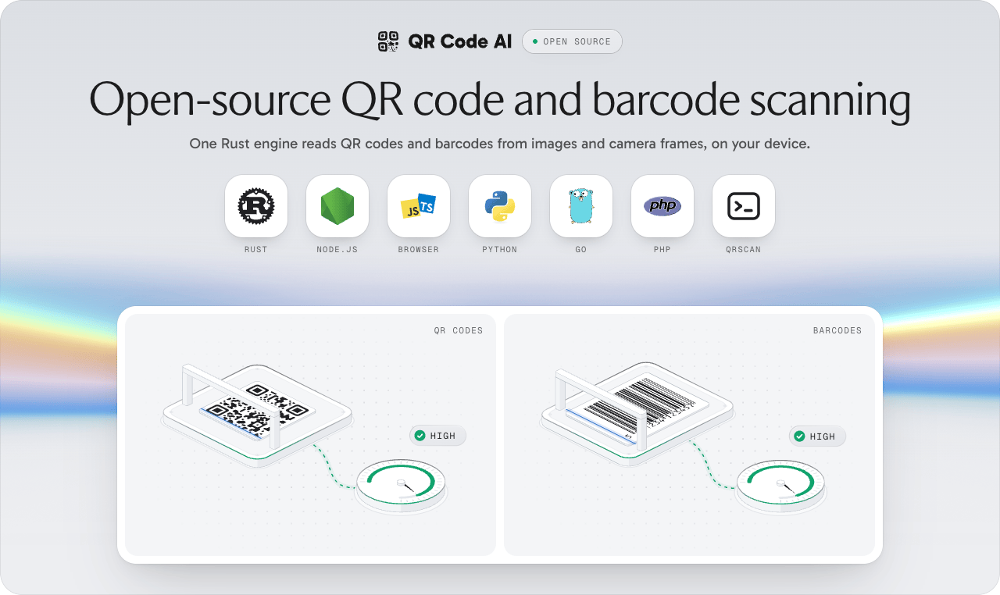
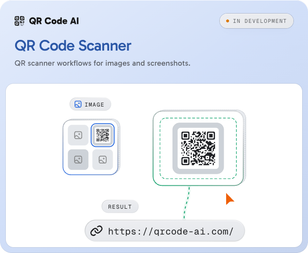
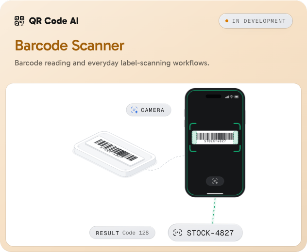
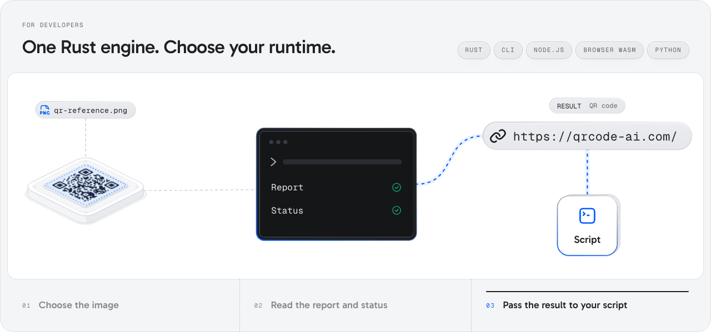
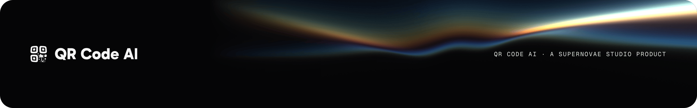

  <a href="https://qrcode-ai.com">
    <picture>
      <source media="(prefers-color-scheme: dark)" type="image/webp" srcset="https://raw.githubusercontent.com/qrcode-ai-com/.github/main/profile/assets/hero-dark.webp?v=50d4c53d9b50">
      <source type="image/webp" srcset="https://raw.githubusercontent.com/qrcode-ai-com/.github/main/profile/assets/hero-light.webp?v=541b28f07cdb">
      <source media="(prefers-color-scheme: dark)" srcset="https://raw.githubusercontent.com/qrcode-ai-com/.github/main/profile/assets/hero-dark.gif?v=3095a1a3aa86">
      
    </picture>
  </a>

# QR Code AI

**QR code and barcode scanning for people and developers.**

QR Code AI develops tools for creating QR codes and reading the codes people encounter every day. Our scanning work focuses on clear results, practical inputs and documented product capabilities.

[Visit QR Code AI](https://qrcode-ai.com) for our current products, QR code creation tools and the latest product information.

## Two dedicated scanning experiences

We are developing separate QR code reader and barcode reader experiences. A photo, a screenshot and a label viewed through a camera present different scanning needs; each product has its own focus.

  <a href="https://qrcode-ai.com/en-US/qr-code-scanner"><picture><source media="(prefers-color-scheme: dark)" srcset="https://raw.githubusercontent.com/qrcode-ai-com/.github/main/profile/assets/product-qr-code-scanner-dark.gif?v=4a56ea72cca4"></picture></a>
  <a href="https://qrcode-ai.com/en-US/barcode-scanner"><picture><source media="(prefers-color-scheme: dark)" srcset="https://raw.githubusercontent.com/qrcode-ai-com/.github/main/profile/assets/product-barcode-scanner-dark.gif?v=c0b2a68457a6"></picture></a>

| Product | Intended focus | Availability |
| --- | --- | --- |
| [QR Code Scanner](https://qrcode-ai.com/en-US/qr-code-scanner) | QR scanner workflows for images and screenshots. | In development; product page in preparation. |
| [Barcode Scanner](https://qrcode-ai.com/en-US/barcode-scanner) | Barcode reading and everyday label-scanning workflows. | In development; product page in preparation. |

The scanner links above identify planned product pages. Use the main website for currently available products and information.

## For developers

  <a href="https://github.com/qrcode-ai-com/qrcode-barcode-scanner">
    <picture>
      <source media="(prefers-color-scheme: dark)" srcset="https://raw.githubusercontent.com/qrcode-ai-com/.github/main/profile/assets/developers-dark.gif?v=8d74eea8ee20">
      
    </picture>
  </a>

This organization hosts public projects, documentation and integration examples as they become ready for release. Each published repository describes its supported inputs, formats, installation and usage.

| Repository | Content |
| --- | --- |
| [qrcode-barcode-scanner](https://github.com/qrcode-ai-com/qrcode-barcode-scanner) | The multiformat QR code and barcode scanner engine, in Rust, and its packages. |
| [qrcode-barcode-scanner-go](https://github.com/qrcode-ai-com/qrcode-barcode-scanner-go) | Go package that reads images through the installed `qrscan` command. |
| [qrcode-barcode-scanner-php](https://github.com/qrcode-ai-com/qrcode-barcode-scanner-php) | PHP package that reads images through the installed `qrscan` command. |
| [homebrew-tap](https://github.com/qrcode-ai-com/homebrew-tap) | Homebrew tap for the `qrscan` command-line scanner. |
| [scoop-bucket](https://github.com/qrcode-ai-com/scoop-bucket) | Scoop bucket for the `qrscan` command-line scanner on Windows. |

Follow [qrcode-ai-com](https://github.com/qrcode-ai-com) for project updates. Product names identify their scanning focus; published documentation explains the capabilities of each release.

## Contact

For product questions, partnerships or feedback, contact [contact@qrcode-ai.com](mailto:contact@qrcode-ai.com).

**[Explore QR Code AI](https://qrcode-ai.com)** · [QR Code Scanner](https://qrcode-ai.com/en-US/qr-code-scanner) · [Barcode Scanner](https://qrcode-ai.com/en-US/barcode-scanner)

  

QR Code AI · A SuperNovae Studio product.
